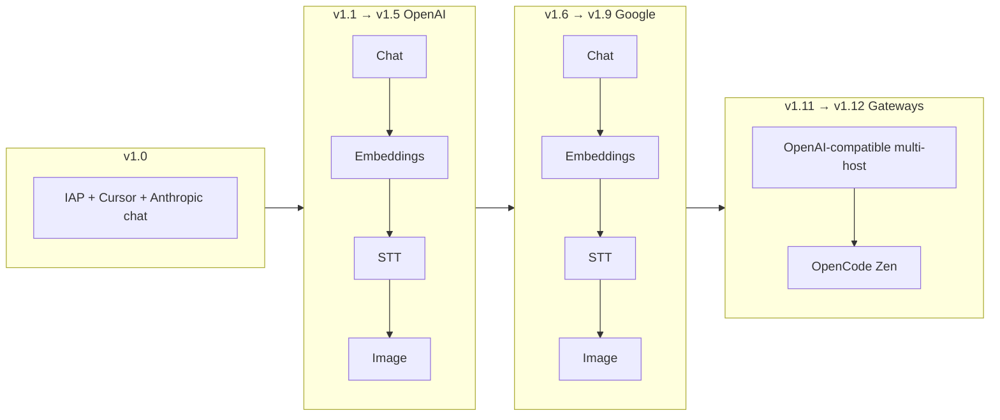

# Roadmap: OpenAI & Google for `ci_ai`

> Status: **Approved roadmap** (2026-10-05)  
> Versioning: **v1.x** minor releases on top of shipped **v1.0** (IAP + Cursor + Anthropic chat).  
> Builds on: [prd-ci-ai.md](./prd-ci-ai.md), [odoo20-ai-bypass-iap-feasibility.md](./odoo20-ai-bypass-iap-feasibility.md)  
> Module: [`modules/odoo_ai/ci_ai`](../../modules/odoo_ai/ci_ai)

## Release line

| Version | Focus | Scope |
|---------|--------|--------|
| **v1.0** | Shipped | Chat: IAP, Cursor, Anthropic. Embeddings / STT / image: IAP only. |
| **v1.1** | OpenAI | Chat + native tool calling (**implemented**) |
| **v1.2** | OpenAI | Embeddings / RAG (`text-embedding-3-small`, `dimensions=1536`) (**implemented**) |
| **v1.3** | OpenAI | Batch speech-to-text (Whisper) (**implemented**) |
| **v1.4** | OpenAI | Image generation (`generate_image` / Images API) (**implemented**) |
| **v1.5** | OpenAI | Realtime STT (`gpt-live-transcribe`) (**implemented**) |
| **v1.6** | Google | Chat + tools (Gemini) (**implemented**) |
| **v1.7** | Google | Embeddings (1536 via `outputDimensionality`) (**implemented**) |
| **v1.8** | Google | Batch STT (Gemini multimodal) (**implemented**) |
| **v1.9** | Google | Image (Gemini image) (**implemented**) |
| **v1.10** | Cleanup | Remove Cursor Cloud Agents chat integration (**implemented**) |
| **v1.11** | OpenAI-compatible | Extend OpenAI provider for multiple OpenAI-compatible gateways (**implemented**) |
| **v1.12** | OpenCode | First-class OpenCode Zen gateway (chat via OpenAI-compatible path) (**planned**) |

Later v1.13+ reserved for polish (Azure deployment UX, Google realtime STT / Vertex auth, etc.) unless scope is reprioritized.

## Why these two

| Provider | Role in `ci_ai` |
|----------|-----------------|
| **OpenAI** | Primary **full-stack** BYO: chat + tools, **1536-dim embeddings** (Odoo RAG default), Whisper STT, image APIs. Highest alignment with IAP capability split. |
| **Google (Gemini)** | Secondary full-stack: chat + tools, embeddings, Speech-to-Text, Imagen / Gemini image. Useful for cost, multimodal, and teams already on Google Cloud. |

**Anthropic** stays as a chat-only option (from v1.0). **Cursor** was removed in v1.10. **Odoo IAP** remains the default and fallback for every capability.

## Target capability matrix

| Capability | v1.0 | After v1.1–v1.5 (OpenAI) | After v1.6–v1.10 | After v1.11–v1.12 |
|------------|------|--------------------------|------------------|-------------------|
| Chat | IAP, Cursor, Anthropic | + OpenAI | + Google Gemini; − Cursor | + OpenAI-compatible gateways; + OpenCode Zen |
| Embeddings / RAG | IAP only | + OpenAI | + Google | OpenAI path may hit compatible hosts that support `/v1/embeddings` |
| Speech-to-text | IAP only | + OpenAI (batch + realtime) | + Google (batch) | Unchanged (OpenAI / Google / IAP) unless gateway supports Whisper |
| Image generation | IAP only | + OpenAI | + Google | Unchanged unless gateway supports Images API |

## Delivery flow

### v1.1 — OpenAI chat

| Item | Detail |
|------|--------|
| Code | `providers/openai_provider.py`, `router.py`, `CHAT_PROVIDERS`, settings UI, tests (mock HTTP) |
| API | POST `/v1/chat/completions` (or Responses API if tool schema fits better) |
| Defaults | Tool-capable chat model (e.g. `gpt-4.1` / `gpt-4o`, configurable) |
| Async | In-request complete (Anthropic-style) |

### v1.2 — OpenAI embeddings (**done**)

| Item | Detail |
|------|--------|
| Code | `OpenAIEmbeddingProvider`, `models/ai_embedding.py`, `embedding_provider` → `openai`, `openai_embedding_model` |
| Default | `text-embedding-3-small` with `dimensions=1536` |
| Notes | New agents get OpenAI default model; existing IAP-named agents need model update / re-index after switch |

### v1.3 — OpenAI STT (**done**)

| Item | Detail |
|------|--------|
| Code | `OpenAITranscriptionProvider`, controller `/ai/transcription`, `mail.call.artifact._transcribe_claimed_record` |
| Default | `whisper-1` (batch) |
| Notes | Batch Whisper; realtime added in v1.5 |

### v1.4 — OpenAI image (**done**)

| Item | Detail |
|------|--------|
| Code | `OpenAIImageProvider`, `ai.tool._generate_image_attachments` |
| Default | `dall-e-3` (b64_json); aspect ratio → size mapping |
| Notes | Prompt-only generation; reference `images_paths` ignored for now |

### v1.5 — OpenAI realtime STT (**done**)

| Item | Detail |
|------|--------|
| Code | `create_realtime_session` → POST `/v1/realtime/client_secrets`; frontend patches for `intent=transcription` + client VAD commit |
| Default | `gpt-live-transcribe` |
| Notes | Ephemeral `session_token` returned to stock voice UI; usage report no-op for OpenAI |

Optional later: Azure `base_url`, image edits.

### v1.6 — Google chat (**done**)

| Item | Detail |
|------|--------|
| Code | `providers/google_provider.py` — Gemini `generateContent`, function declarations ↔ Odoo `tool_call` |
| Auth | API key (AI Studio); optional Vertex / service account in a later patch |
| Default | `gemini-2.5-flash` |

### v1.7 — Google embeddings (**done**)

| Item | Detail |
|------|--------|
| Code | `GoogleEmbeddingProvider` — `embedContent` / `batchEmbedContents` with `outputDimensionality=1536` |
| Default | `gemini-embedding-001` |
| Notes | Matches Odoo Vector size; switching providers may require re-embed |

### v1.8 — Google STT (**done**)

| Item | Detail |
|------|--------|
| Code | `GoogleTranscriptionProvider` — multimodal `generateContent` with inline audio (AI Studio key) |
| Default | `gemini-2.5-flash` |
| Notes | Batch only; realtime browser STT returns a clear error (use OpenAI or IAP). Cloud Speech-to-Text OAuth deferred. |

### v1.9 — Google image (**done**)

| Item | Detail |
|------|--------|
| Code | `GoogleImageProvider` — Gemini image `responseModalities: IMAGE` |
| Default | `gemini-2.5-flash-image` |
| Notes | Aspect ratio mapped via `imageConfig.aspectRatio` |

### v1.10 — Remove Cursor (**done**)

| Item | Detail |
|------|--------|
| Removed | `providers/cursor_provider.py`, Cursor settings UI, `cursor` chat selection |
| Session | Dropped postcommit scheduling path (Cursor-only); all BYO chat completes in-request |
| Migration | `20.0.1.10.0` pre-migrate resets `chat_provider=cursor` → `iap` |

**Google default models** (all configurable): chat `gemini-2.5-flash`, embedding `gemini-embedding-001` @ 1536, STT `gemini-2.5-flash`, image `gemini-2.5-flash-image`.

### v1.11 — OpenAI-compatible multi-gateway (**done**)

Goal: let admins point the existing OpenAI adapter at common OpenAI-compatible hosts (DeepSeek, Groq, OpenRouter, Azure OpenAI, Ollama, etc.) without a separate provider per vendor.

| Item | Detail |
|------|--------|
| Code | `providers/openai_gateways.py`, extend `openai_provider.py`, `http_security.py`, `ci.ai.provider.config`, Settings → AI |
| Config | `openai_gateway` preset + `openai_base_url` (Azure / Custom / Ollama); named SaaS presets fix the host |
| Chat | `/v1/chat/completions` on all presets |
| Embeddings / STT / image | OpenAI + Azure full stack; Ollama chat + embeddings; others chat-only (validation + runtime errors) |
| Security | HTTPS allowlist for known hosts; path prefixes for Groq/OpenRouter; HTTP loopback only for Ollama |
| Tests | `test_openai_gateways.py` — DeepSeek + Groq mock chat URLs; capability / host rejection |

Presets: OpenAI, DeepSeek, Groq, OpenRouter, Azure OpenAI, Ollama (`http://127.0.0.1:11434`), Custom.

### v1.12 — OpenCode Zen (**planned**)

Goal: first-class **OpenCode Zen** option so users who already use [OpenCode](https://opencode.ai/docs/zen/) can bring that key into Odoo AI.

| Item | Detail |
|------|--------|
| Depends on | v1.11 OpenAI-compatible gateway plumbing |
| Code | Settings enable + `opencode` (or preset under OpenAI-compatible) routing to `https://opencode.ai/zen/v1` |
| Auth | OpenCode Zen API key |
| Chat | Prefer `/v1/chat/completions` models (DeepSeek / GLM / Kimi / MiniMax / Qwen family on Zen). Document which Zen models use `/v1/responses` and defer those unless the OpenAI adapter already supports Responses |
| Scope | Chat first; embeddings / STT / image stay on IAP / OpenAI / Google unless Zen exposes compatible APIs |
| Tests | Mock Zen chat completion + tool round-trip; host allowlist includes `opencode.ai` |

**Product note:** v1.11 is the generic escape hatch; v1.12 is a named, documented preset for a popular gateway so non-experts do not hand-edit base URLs.

## Config & UI (each v1.x release)

Extend singleton `ci.ai.provider.config` and **Settings → AI** (same pattern as Anthropic / OpenAI):

1. Enable checkbox + API key (+ optional base URL for OpenAI-compatible gateways).
2. Model fields per capability where needed (chat, embedding, STT, image).
3. Expand capability routing selections as each release lands (`openai` from v1.2–v1.5 on relevant rows; `google` from v1.6–v1.9).
4. Validation: enable + key required before selecting provider on any capability.
5. Help text: which capabilities still use IAP.

## Implementation conventions (reuse v1.0 patterns)

| Area | Convention |
|------|------------|
| Chat sync | `ai.session._get_completions` → router → `provider.complete()` |
| Chat async | `ai.session._save_and_submit_request` → in-request complete unless latency forces postcommit |
| Errors | `_ci_ai_rescue_session` — always post Discuss error, no silent "Thinking" |
| Tests | Mock `_http_json` / urllib; no real keys in CI |
| Types | Map to Odoo `AssistantMessage` / `ToolCallPart` via `providers/base.py` helpers |

## OpenAI adapter checklist (v1.1)

- [x] `OpenAIChatProvider.complete()`
- [x] Map Odoo messages ↔ OpenAI roles; `tool_calls` ↔ `tool_call` parts; `tool` role for results
- [x] Router branch + `openai_enabled`, `openai_api_key`, `openai_model`, `openai_base_url`
- [x] `test_adapters.py` — tool call round-trip
- [x] `test_session.py` — skips IAP when chat=`openai`

## OpenAI embeddings checklist (v1.2)

- [x] `OpenAIEmbeddingProvider.embed()` — POST `/v1/embeddings`, `dimensions=1536`
- [x] Inherit `ai.embedding._get_embeddings` / default / supported models
- [x] `embedding_provider` selection + `openai_embedding_model` + validation
- [x] `test_embeddings.py` — router, mock HTTP, IAP skip

## OpenAI STT checklist (v1.3)

- [x] `OpenAITranscriptionProvider.transcribe()` — multipart `/v1/audio/transcriptions`
- [x] Override `/ai/transcription` + call artifact STT
- [x] `stt_provider` + `openai_stt_model` + tests

## OpenAI image checklist (v1.4)

- [x] `OpenAIImageProvider.generate()` — `/v1/images/generations` b64
- [x] Override `ai.tool._generate_image_attachments`
- [x] `image_provider` + `openai_image_model` + tests

## OpenAI realtime STT checklist (v1.5)

- [x] `create_realtime_session()` — POST `/v1/realtime/client_secrets` with `gpt-live-transcribe`
- [x] Override `/ai/transcription/session` + no-op usage report for OpenAI
- [x] Frontend patches: `intent=transcription` + client VAD commit
- [x] `openai_realtime_stt_model` + tests

## Google adapter checklist (v1.6–v1.9)

- [x] `GoogleChatProvider.complete()` — Gemini API with `tools` / function calling
- [x] Config: `google_enabled`, `google_api_key`, `google_model`, `google_base_url`
- [x] Tests mirroring Anthropic/OpenAI tool mapping
- [x] `GoogleEmbeddingProvider.embed()` — `outputDimensionality=1536`
- [x] `GoogleTranscriptionProvider.transcribe()` — multimodal batch STT
- [x] `GoogleImageProvider.generate()` — Gemini image modalities
- [x] Router + Settings UI + validation for all four capabilities

## Out of scope for this roadmap (unless reprioritized)

- Native adapters per cheap lab (DeepSeek / Groq / Mistral) beyond OpenAI-compatible reuse
- Full OpenCode Zen `/v1/responses` model catalog (unless OpenAI adapter already uses Responses)
- Replacing Odoo web-grounding scraper with BYO search
- Community Edition AI (Enterprise `ai` only)
- Removing IAP entirely (keep as fallback)
- Google Vertex service-account auth / Cloud Speech-to-Text OAuth / Google realtime STT

## Success criteria

1. From **v1.5** (**met**), admin can route **Chat**, **Embeddings**, **STT** (batch + realtime), and **Image** to OpenAI independently of IAP (IAP fallback documented).
2. RAG keeps **1536-dimensional** vectors without schema changes (**met**).
3. From **v1.9** (**met**), same four capabilities routable to Google (STT batch-only).
4. From **v1.11**, admin can route **Chat** through an allowlisted OpenAI-compatible gateway via base URL + key.
5. From **v1.12**, admin can enable **OpenCode Zen** with a Zen API key and select a chat/completions model without editing raw host allowlists by hand.
6. Mocked tests per release; no regression on Anthropic / IAP / OpenAI / Google paths.

## OpenAI-compatible gateway checklist (v1.11)

- [x] Expand `http_security` allowlist / presets for known compatible hosts
- [x] Settings UX: gateway preset or custom HTTPS base URL + model id
- [x] Chat works against at least two non-OpenAI hosts (mock)
- [x] Clear errors when embeddings / STT / image hit unsupported gateway endpoints
- [x] Docs: which capabilities require first-party OpenAI vs any chat-completions host

## OpenCode Zen checklist (v1.12)

- [ ] Enable + API key under Settings → AI (named OpenCode / Zen)
- [ ] Default base URL `https://opencode.ai/zen/v1` on allowlist
- [ ] Chat model field with documented chat/completions examples
- [ ] Router / selection path (preset under OpenAI-compatible or `opencode` chat provider)
- [ ] Mocked chat + tool tests; help text linking to OpenCode Zen docs

## References

- OpenAI: Chat Completions, Embeddings, Audio, Images API docs
- Google: Gemini API (generateContent, embedContent), Cloud Speech-to-Text, Imagen
- OpenCode Zen: https://opencode.ai/docs/zen/ (`/zen/v1/chat/completions`, `/zen/v1/responses`)
